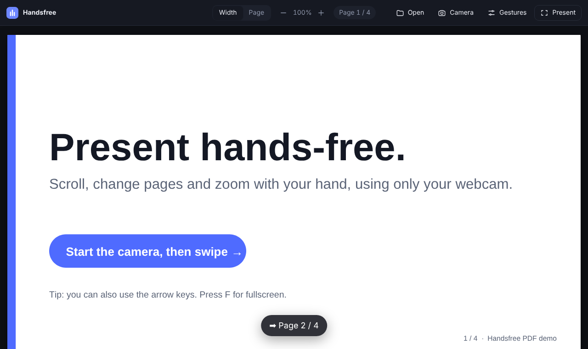
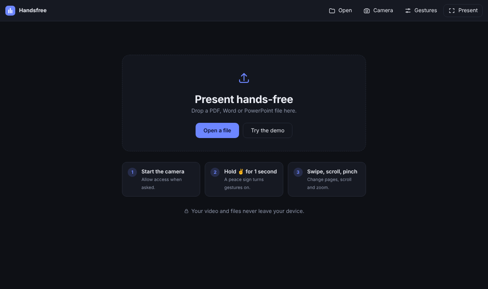
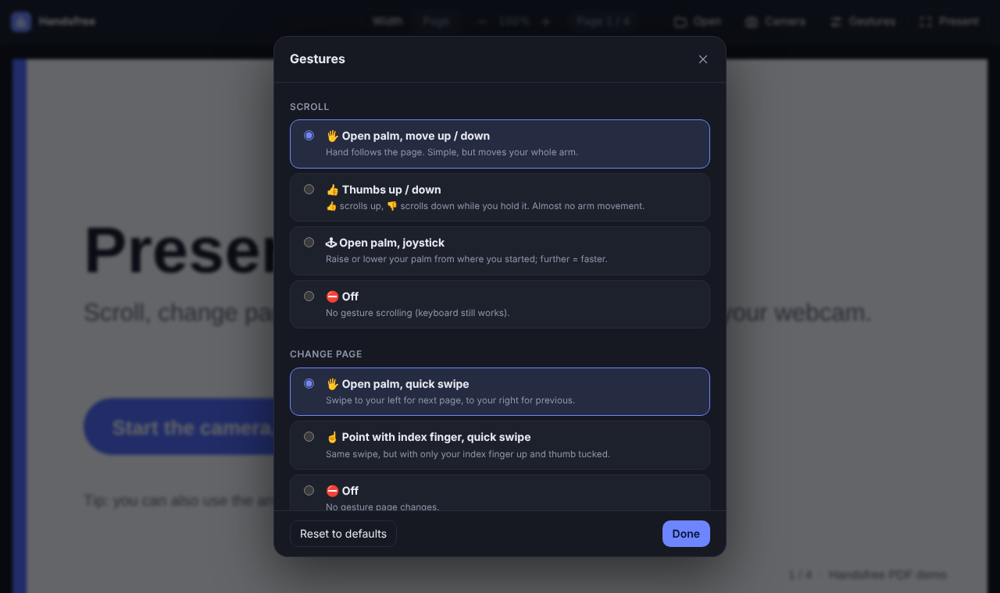

# Handsfree PDF

**Present a PDF, Word document or PowerPoint deck without touching your keyboard or mouse.**
Your webcam watches your hand: swipe to change pages, move to scroll, pinch to zoom, point to show something.
It runs entirely in your browser, with nothing to install and nothing uploaded.

**[Try it online](https://an-average-student.github.io/handsfree-pdf/)** (the *Try the demo* button opens a sample, no file needed)



| Welcome screen | Choose your gestures |
|---|---|
|  |  |

## Features

- **Opens PDF, Word (.docx) and PowerPoint (.pptx).** See [what it opens](#what-it-opens).
- **Hand gestures:** change page, scroll, zoom and a **laser pointer**, each with several gesture choices.
- **Your own gestures:** record any hand pose and assign it to an action.
- **Presentation mode:** fullscreen, one page fitted to the screen, with on-slide messages so the audience sees what you did.
- **Private by design:** video and files never leave your device. No account, no tracking, no server. See [Privacy and security](#privacy-and-security).
- **Light and dark themes** (follows your system), keyboard shortcuts, works on phones and tablets for viewing.

## How to use

1. Click **Camera** and allow access. A small preview appears (collapse it with the arrow; tracking keeps running).
2. Hold a **peace sign** ✌️ for 1 second to turn gesture control **on**. Do it again to turn it off.
3. Use your gestures. Open **Gestures** to change what does what.

Default gestures:

| Do this | To do this |
|---|---|
| ✌️ Hold 1 second | Gestures on / off |
| 🖐 Open palm, quick swipe left / right | Next / previous page |
| 🖐 Open palm, move up / down | Scroll (a quicker hand scrolls further) |
| 👌 Pinch, then move up / down | Zoom in / out |
| ☝️ Index finger | Laser pointer (red dot follows your fingertip) |
| ✊ Fist | Rest: nothing happens |

### Choose your gestures

| Action | Choices |
|---|---|
| Scroll | Open palm up/down · Thumbs up/down (hold longer = faster) · Open palm "joystick" · Off |
| Change page | Open palm swipe · Index-finger swipe · Off |
| Zoom | Pinch + move · L-shape spread/close · Off |
| Laser pointer | Point with index finger · Off |

Sliders for **Scroll speed**, **Pointer speed** and **Sensitivity**, and a switch for the on-slide messages. Everything is saved in your browser.
Pointing is also the pose for the index-finger page swipe, so pick one of the two (the panel warns you).

### My gestures (custom poses)

**Gestures → My gestures → Add a gesture:** name it, choose what it does (next / previous / first / last page, presentation mode, or gestures on/off), press **Record**.
The panel closes, a 3-2-1 countdown runs, and you hold your pose still for 2 seconds. Later, hold it for about half a second to trigger it.

- Only the *shape* matters, not where your hand is, how big it looks or how it's tilted.
- Poses that look like a built-in gesture (open palm, fist, peace sign...) are refused, as are shaky recordings and poses too similar to one you've saved. Try three fingers up, or index + pinky.
- A pose fires once per hold; let go before using it again. Only "gestures on/off" works while gestures are off.
- Up to 8 gestures, stored only in your browser. (The presentation action can't enter fullscreen without a click; it hides the toolbar.)

### Keyboard

| Key | Action |
|---|---|
| `O` | Open a file |
| `C` | Start / stop camera |
| `F` | Presentation mode (`Esc` exits) |
| ← / → or Page Up / Down | Previous / next page |
| ↑ / ↓ | Scroll |
| `Home` / `End` | First / last page |
| `+` / `-` | Zoom |

Browser shortcuts (Ctrl/Cmd + F, + / - ...) are left alone.

## What it opens

| Type | Notes |
|---|---|
| **PDF** | Best fidelity. Only the pages near the screen are drawn, so long files stay light (a 300-page test file used about 23 MB instead of about 1.9 GB). |
| **Word (.docx)** | Redrawn in the browser, one page per Word page. |
| **PowerPoint (.pptx)** | Redrawn in the browser, one slide per page, any slide shape (4:3, 16:9...). |

Drop a file on the page or use **Open** (limit 150 MB).

**Word and PowerPoint are redrawn, not rendered by Word or PowerPoint**, so they won't look identical. Expect substituted fonts when yours aren't installed, no animations, transitions or embedded video, and charts that may not draw fully (a chart made with python-pptx drew its axes but no bars, and shows a Chinese default title; charts made in PowerPoint are untested). If a file must look exactly right, export it to PDF first.
Old `.doc` / `.ppt` files aren't supported (save as `.docx` / `.pptx`). A Word file with no page breaks shows as one long page, and "next page" then scrolls a screenful.

## Tips for reliable tracking

- Face a window or lamp so light falls on your hand, not behind it.
- Keep your hand about an arm's length from the camera, fully in view.
- If a gesture isn't recognised, look at the status line on the camera card. It names the pose the app sees.
- Raise **Scroll speed** for long documents; lower **Pointer speed** if the dot feels jumpy.

## Browser support

Built with modern web features (WebAssembly, `getUserMedia`, CSS `color-mix` and `:has`), so use a current browser.
**Tested only in Chromium (Chrome/Edge).** Firefox and Safari have not been tested; reports are welcome.
Camera access needs `https://` (or `localhost`), which the hosted version provides.

## Privacy and security

- **Your video never leaves your device.** Hand tracking runs locally with MediaPipe (WebAssembly). Nothing is recorded or uploaded.
- **Your files never leave your device.** There is no server.
- **No accounts, analytics, cookies or third-party requests.** The hand-tracking model is served from the same site.
- **A strict Content-Security-Policy** means the browser refuses inline scripts, `eval`, scripts from other sites, remote images and any network request to another site, so even a malicious document couldn't send data out. (Checked by attacking it: all of those are blocked.)
- **Documents are treated as untrusted:** Word/PowerPoint output is sanitised, PDF.js runs with `eval` and XFA disabled, and files over 150 MB are refused.
- **Supply chain:** `npm audit` runs in CI and fails the deploy on high severity; Dependabot proposes updates; GitHub Actions are pinned to exact commits.

Full details, known limits and how to report a vulnerability: [SECURITY.md](SECURITY.md).

## Development

```bash
npm install
npm run dev      # local dev server
npm test         # unit tests (gesture logic, filters, file types, PDF page planning, custom gestures)
npm run build    # production build into dist/
```

Pushing to `main` runs the tests and deploys to GitHub Pages ([workflow](.github/workflows/deploy.yml)).

| File | What it does |
|---|---|
| `src/main.js` | The app: viewer, toolbar, camera, wiring everything together |
| `src/gestures.js` | Turns hand landmarks into actions (poses, scroll, swipe, zoom, pointer, custom triggers) |
| `src/custom-gestures.js` | Recording, matching and validating user-made gestures |
| `src/filters.js` | One Euro filter that steadies the laser pointer |
| `src/settings.js`, `src/settings-ui.js` | The list of choices, saved settings, and the Gestures panel |
| `src/pdf-view.js` | Draws only the visible PDF pages (keeps memory low) |
| `src/formats.js`, `src/filetypes.js` | Word/PowerPoint loading and sanitising; file type detection |
| `src/hands.js` | Camera and MediaPipe hand tracking |
| `tests/` | Unit tests (Node's built-in test runner) |

### Adding a gesture option

1. Add an entry to `OPTIONS` in `src/settings.js`. It appears in the panel automatically.
2. Implement its behaviour in `src/gestures.js` (and a pose in `classify()` if it needs one).
3. Add tests in `tests/` and run `npm test`.

Gesture tuning numbers (hold times, thresholds, speeds) are all in the `CONFIG` block at the top of `src/gestures.js`.

### Dependency note

`package.json` pins `echarts` and `uuid` through `overrides`: `pptx-preview` depends on older versions with known advisories, and a malicious `.pptx` is exactly the input that could reach them.
If you update `pptx-preview`, run `npm audit` and re-test a deck that contains a chart before removing the overrides.

## Built with

[PDF.js](https://github.com/mozilla/pdf.js) (PDF), [docx-preview](https://github.com/VolodymyrBaydalka/docxjs) (Word), [pptx-preview](https://www.npmjs.com/package/pptx-preview) (PowerPoint), [MediaPipe Hands](https://github.com/google-ai-edge/mediapipe) (hand tracking) and [Vite](https://vitejs.dev).

## Ideas for later

- A browser extension so gestures can drive Google Slides / PowerPoint Online (a web page can't control another site's tab, so this needs an extension).
- Testing and fixes for Firefox and Safari.
- More custom-gesture actions.

## License

MIT
